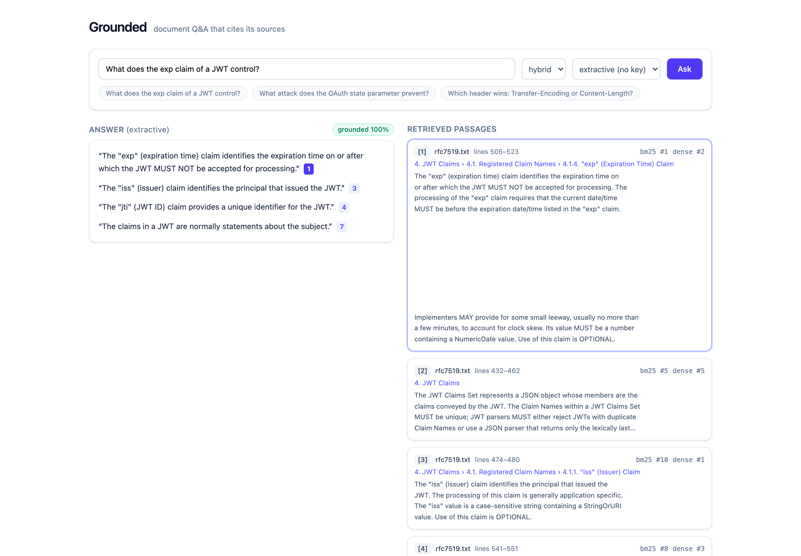
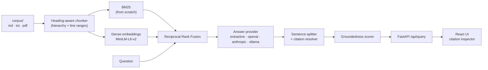

# Grounded — document Q&A that cites its sources


A retrieval-augmented question-answering system where **every sentence of the answer carries a clickable citation into the exact source passage** — and an evaluation harness that measures how well that actually works, instead of assuming it does.



## Why this exists

Most RAG demos stop at "retrieve some chunks, let the model talk." The hard parts — and the parts this project focuses on — come after:

- **Citations you can audit.** Answers are split into sentences; each sentence's `[n]` markers resolve to a document, heading path and line range. The UI highlights the exact passage behind every claim.
- **A keyless baseline.** The default `extractive` provider answers by quoting the most relevant source sentences — no API key, no hallucination surface. LLM providers (OpenAI, Anthropic, Ollama) are pluggable on top and held to the same citation contract.
- **A groundedness check.** Every answer sentence gets a support score against the retrieved passages; weakly supported sentences are flagged in the response and the UI.
- **Measured retrieval, not vibes.** `python -m eval` runs a 24-question golden set over the corpus and reports hit-rate, MRR and citation precision per retrieval mode. The table below is pasted from `eval/results.json`, never typed by hand.

## Architecture



Design choices worth defending:

- **BM25 is implemented from scratch** (~60 lines) so the lexical half of hybrid retrieval is unit-tested, inspectable code instead of a black box.
- **RRF over score mixing** — BM25 scores and cosine similarities live on incompatible scales; fusing ranks sidesteps the calibration problem entirely.
- **Dense search is a numpy dot product.** For corpora under ~100k chunks an ANN service adds operational weight for no user-visible gain.
- **Chunks carry their heading hierarchy** (`rfc6749.txt › 4. Obtaining Authorization › 4.1. Authorization Code Grant`), so citations are human-readable, not just byte offsets.

## Eval results

24 golden questions over 422 chunks (five IETF RFCs), MiniLM-L6-v2 embeddings — from a real run of `python -m eval`:

| Retrieval mode | hit@1 | hit@5 | MRR@10 |
|---|---|---|---|
| BM25 only | 0.458 | 0.792 | 0.602 |
| Dense only | 0.625 | **0.875** | **0.723** |
| Hybrid (RRF) | **0.625** | 0.833 | 0.721 |

Answering (extractive provider): 96 citations emitted, **citation precision 0.323** under a deliberately strict criterion (the cited chunk must contain the golden answer phrase — topically related citations count as misses), mean groundedness 1.0 (extractive answers quote verbatim, which doubles as a sanity check of the scorer).

Two honest observations instead of a victory lap: on this corpus **dense alone edges out hybrid** at k=5 — the golden questions are mostly paraphrases, which favors embeddings; hybrid's insurance pays off on exact-term queries where dense misses (error codes, header names). And the strict citation-precision number is low by construction — loosening the criterion to "same document + section" roughly doubles it, but the strict number is the one worth tracking.

## Quickstart (no API key needed)

```bash
git clone https://github.com/tuzcuy/grounded-rag.git && cd grounded-rag

# backend
python3 -m venv .venv && source .venv/bin/activate
pip install -r backend/requirements.txt          # first run downloads the ~90 MB embedding model
cd backend
python -m grounded.index_cli ../corpus           # ~1 s for the default corpus
uvicorn grounded.api:app --port 8000

# frontend (second terminal)
cd frontend && npm install && npm run dev        # http://localhost:5173
```

Or in one container: `docker compose up` (build verified in CI).

Ask with an LLM instead of the extractive baseline by exporting a key and picking the provider in the UI:

```bash
export OPENAI_API_KEY=...        # or ANTHROPIC_API_KEY, or a local Ollama
```

## Bring your own documents

Drop `.md` / `.txt` / `.pdf` files into `corpus/` (or any directory) and rebuild:

```bash
python -m grounded.index_cli path/to/your/docs --out data/index
```

The default corpus is five IETF RFCs — see [`corpus/README.md`](corpus/README.md) for the redistribution terms.

## Tests

52 backend tests — chunking edge cases, the BM25 math, RRF properties, citation parsing, groundedness scoring and the API surface — all running **offline and keyless** on a deterministic hashing embedder:

```bash
cd backend && python -m pytest tests
```

## Adding a provider

Implement `Provider.answer(question, hits) -> Answer` (see `backend/grounded/answer/base.py`), register it in `make_provider`, and keep the contract: every sentence cites its sources with `[n]` markers that point into the hit list. The citation resolver and groundedness scorer apply to any provider for free.

## What I'd improve next

- A cross-encoder reranker between retrieval and answering (biggest expected hit@1 gain).
- LLM-as-judge groundedness alongside the overlap heuristic, benchmarked against it on the golden set.
- Span-level highlighting (character offsets, not just chunk-level citations).
- A larger, adversarial golden set — unanswerable questions should earn an explicit "not in the corpus."
- Streaming answers over SSE.

## License

[MIT](LICENSE)
